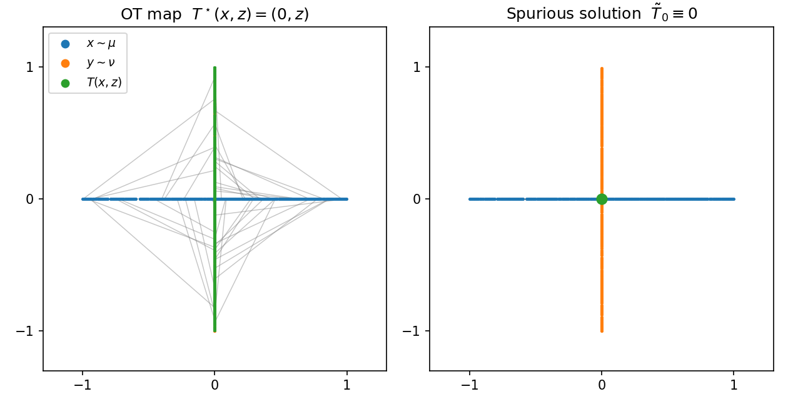
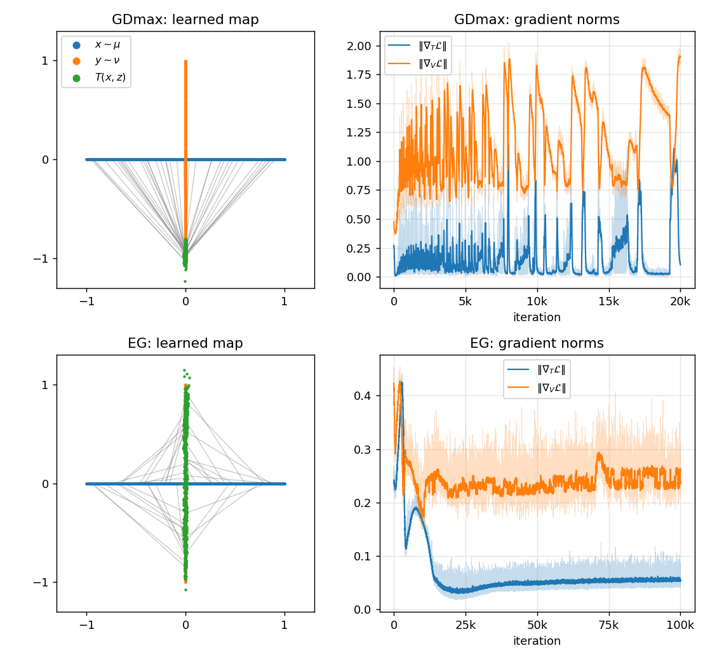
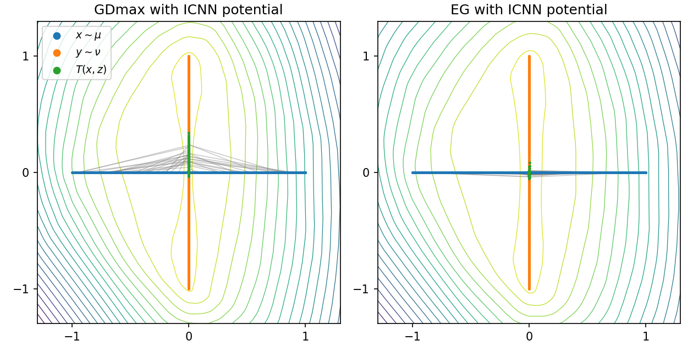
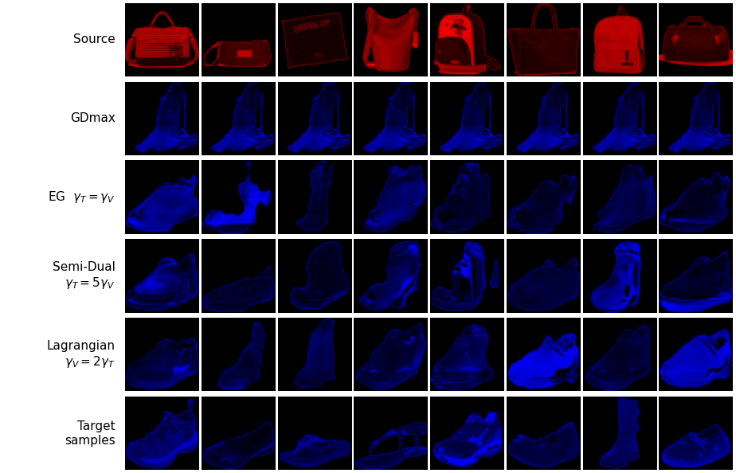

# Minimax Optimization without Spurious Solutions in Optimal Transport Learning

**NeurIPS 2026** · Paper: TBU

<!-- TODO: author list -->

> **TL;DR.** Spurious solutions in neural optimal transport are **not stationary points**, so an extragradient method that converges to stationary points recovers the OT map **without any regularization**, in both the Semi-Dual and the Lagrangian formulations.

## Overview

### Semi-Dual Neural OT

Given a source distribution $\mu$, a target distribution $\nu$, and the quadratic cost $c(x, y) = \alpha\|x - y\|^2$, neural OT jointly learns a transport map $T$ and a potential $V$, both parameterized by neural networks, through the objective

```math
\mathcal{L}(T, V) = \int_{\mathcal{X}\times\mathcal{Z}} \Big[\, c\big(x, T(x, z)\big) - V\big(T(x, z)\big) \Big]\, d(\mu\times\xi)(x, z) \;+\; \int_{\mathcal{Y}} V(y)\, d\nu(y).
```

The map may take a noise input $z \sim \xi$ so that it can split mass (weak OT; Korotin et al., 2023). For a deterministic map, $T(x, z) \equiv T(x)$. The widely used **Semi-Dual OT** problem (Rout et al., 2022; Fan et al., 2022; Korotin et al., 2023) is

```math
\max_{V}\ \min_{T}\ \mathcal{L}(T, V).
```

### What Is a Spurious Solution?

If an OT map $T^\star$ and a Kantorovich potential $V^\star$ exist, the pair $(T^\star, V^\star)$ is a global solution of the Semi-Dual problem. The converse fails, however. For a fixed optimal potential $V^\star$, the inner minimization only asks $T$ to send each $x$ to *some* minimizer of $c(x, \cdot) - V^\star(\cdot)$. When this minimizer is not unique, which can happen when $\mu$ is not absolutely continuous (e.g., supported on a lower-dimensional set), many maps reach the optimal value without satisfying $T_\sharp(\mu\times\xi) = \nu$. Choi et al. (2025) refer to these global solutions that are not OT maps as **spurious solutions**.

**Perpendicular example** (Choi et al., 2025). Let $\mu$ be uniform on the horizontal segment $[-1, 1]\times\{0\}$, $\nu$ uniform on the vertical segment $\{0\}\times[-1, 1]$, and $c(x, y) = \tfrac12\|x - y\|^2$. Then $V^\star(y) = -|y_1| + \tfrac12 y_2^2$ is an optimal potential. For $x = (x_1, 0)$,

```math
c(x, w) - V^\star(w) = \tfrac12 (w_1 - x_1)^2 + |w_1|,
```

which is minimized by any point with $w_1 = 0$, regardless of $w_2$. Hence the map $\tilde T_0 \equiv 0$, which collapses all of $\mu$ to the origin, forms a global solution $(\tilde T_0, V^\star)$ of the Semi-Dual problem, even though $(\tilde T_0)_\sharp(\mu\times\xi) = \delta_0 \neq \nu$.

<p align="center">
  
</p>

### Spurious Solutions Are Not Stationary

A global solution of a nonconvex–nonconcave minimax problem need not be a stationary point (Jin et al., 2020). Our main result shows that this gap is exactly what separates spurious from optimal solutions.

> **Theorem 3.3 (simplified).** For the quadratic cost, a global solution $(T^\star, V^\star)$ of the Semi-Dual problem is non-spurious **if and only if** it is a stationary point, i.e., $\nabla_V \mathcal{L}(T^\star, V^\star) = 0$.

The reason is that $\mathcal{L}$ is linear in $V$, and its derivative in the direction $\phi$ measures the mismatch between $\nu$ and the pushforward of $\mu$:

```math
\big\langle \nabla_V \mathcal{L}(T, V), \phi \big\rangle = \int_{\mathcal{Y}} \phi(y)\, d\nu(y) - \int_{\mathcal{X}\times\mathcal{Z}} \phi\big(T(x, z)\big)\, d(\mu\times\xi)(x, z).
```

This vanishes for every test function $\phi$ exactly when $T_\sharp(\mu\times\xi) = \nu$. In the perpendicular example, $\phi = \mathbf{1}_{\{y = 0\}}$ gives a derivative of $\nu(\{0\}) - 1 = -1 \neq 0$ at $(\tilde T_0, V^\star)$. **An optimizer that converges to a stationary point therefore cannot end at a spurious solution.** This raises the question of why spurious solutions are observed in practice. We identify two causes.

### Why Are Spurious Solutions Observed?

#### 1. The optimizer does not reach a stationary point

The most common optimizer for the Semi-Dual problem is **GDmax**. It approximates the inner minimization over $T$ with a few descent steps, then takes one ascent step on $V$:

```text
GDmax                                     (src/train.py: train_gdmax)
for t = 1, 2, ...:
    sample x ~ μ, z ~ ξ, y ~ ν
    repeat K times:                       # approximate min_T L(T, V)
        T ← T − γ_T ∇_T L(T, V)
    V ← V + γ_V ∇_V L(T, V)               # one ascent step on V
```

GDmax (like simultaneous GDA) can cycle instead of converging, even on simple bilinear problems (Mescheder et al., 2018). **Extragradient (EG)** (Korpelevich, 1976) first takes a look-ahead step, then updates the current point with the gradients evaluated at the look-ahead point:

```text
Extragradient                             (src/train.py: train_extragradient)
for t = 1, 2, ...:
    sample x ~ μ, z ~ ξ, y ~ ν
    # 1) extrapolation (look-ahead)
    T̄ ← T − γ_T ∇_T L(T, V)
    V̄ ← V + γ_V ∇_V L(T, V)
    # 2) update with the gradients at the look-ahead point
    T ← T − γ_T ∇_T L(T̄, V̄)
    V ← V + γ_V ∇_V L(T̄, V̄)
```

The step sizes $\gamma_T$ and $\gamma_V$ can differ (two-timescale EG). In the nonconvex–nonconcave setting, EG with a sufficiently smaller step size on the outer variable almost surely escapes strict non-minimax points while remaining stable at global solutions (Chae et al., 2024; Kim & Kim, 2024).

On the perpendicular example, **GDmax does not converge: its gradient norms keep spiking instead of decreasing, and its final map collapses $\mu$ onto a small piece of $\nu$. EG's gradient norms settle at a low, stable level, and EG finds the non-spurious global solution**, a map that spreads $\mu$ over the whole vertical segment $\nu$.

<p align="center">
  
</p>

#### 2. The c-concavity constraint makes spurious solutions stationary

Many prior works restrict the potential to c-concave functions. For the quadratic cost these are $V(y) = \alpha\|y\|^2 - u(y)$ with $u$ convex, and $u$ is parameterized by an Input Convex Neural Network (ICNN; Amos et al., 2017). The restriction leaves the optimal value unchanged and improves the loss landscape (Makkuva et al., 2020; Taghvaei & Jalali, 2019). In fact, it turns the problem into a constrained convex–concave one, which stabilizes training.

The same constraint, however, makes spurious solutions stationary. **When the OT map must split mass, the averaged map $\tilde T(x) = \mathbb{E}_{z\sim\xi}[T^\star(x, z)]$ together with $V^\star$ is a stationary spurious global solution of the constrained problem, and even a Nash equilibrium.** In the perpendicular example the OT map is $T^\star(x, z) = (0, z)$ with $z \sim \mathcal{U}([-1, 1])$, so the averaged map is again the collapse $\tilde T \equiv 0$. With an ICNN potential, both GDmax and EG end at (or next to) this collapsed map instead of the OT map:

<p align="center">
  
</p>

The c-concavity constraint thus makes the problem easier for gradient methods, but the solution they reach need not be the OT map. It is unsuitable for recovering the OT map.

### Our Approach: No Constraint, Extragradient on Two Formulations

Together, these observations give a simple recipe. **Leave the potential unconstrained, and use an optimizer that converges to stationary points.** Every stationary global solution is then an OT map, so no regularization of the objective or smoothing of $\mu$ is needed. We apply EG to two formulations that share the same objective $\mathcal{L}$:

- **Semi-Dual OT**: $\max_V \min_T \mathcal{L}(T, V)$, the formulation used in prior work.
- **Lagrangian-based OT**: $\min_T \max_V \mathcal{L}(T, V)$, the same objective with the order of min and max swapped. Here $V$ acts as a Lagrange multiplier for the constraint $T_\sharp(\mu\times\xi) = \nu$. **Every global solution of this formulation is an OT map**, so spurious solutions are ruled out by the formulation itself. Because the inner $\max_V$ is $+\infty$ unless the constraint holds, the formulation is intractable for GDmax. EG never needs an inner maximization oracle, so it can still train it.

Since the objective is identical, **the two formulations differ only in the ratio of the step sizes**. The inner (faster) player gets the larger step size:

| Formulation | Problem | Step sizes |
|---|---|---|
| Semi-Dual | $\max_V \min_T \mathcal{L}(T, V)$ | $\gamma_T \ge \gamma_V$ |
| Lagrangian | $\min_T \max_V \mathcal{L}(T, V)$ | $\gamma_T \le \gamma_V$ |

Standard EG ($\gamma_T = \gamma_V$) sits between the two. In the code, the potential $V$ is called `f`. Both formulations therefore run through the same function, `train_extragradient(T, f, ..., lr_T=γ_T, lr_f=γ_V)`.

On image translation (red handbags → blue shoes), GDmax collapses every handbag to the same shoe. EG produces diverse shoes that follow the shape of each handbag. The figure shows EG with equal step sizes, the Semi-Dual setting with $\gamma_T = 5\gamma_V$, and the Lagrangian setting with $\gamma_V = 2\gamma_T$:

<p align="center">
  
</p>

## Experimental Setup

- **2D synthetic data** (Perpendicular, Horizontal, One-to-Many, Grid; Choi et al., 2025). $\mu$ and $\nu$ are uniform on line segments in $\mathbb{R}^2$, and spurious solutions are known to exist. The stochastic map $T(x, z)$ takes Gaussian noise $z$. $T$ and $V$ are two-hidden-layer ReLU MLPs of width 64; $V$ is replaced by an ICNN for the c-concave experiment. Batch size is 1024. EG uses plain gradient steps and GDmax uses Adam. The smoothing baseline (Choi et al., 2025) adds annealed Gaussian noise to $\mu$ and trains with GDmax at batch size 128.
- **MNIST 2 → 3** (16×16, deterministic map). There are two variants:
  - *Red-to-Blue*: all 2s go in the red channel and all 3s in the blue channel, so the supports are orthogonal.
  - *Multi-colored*: every image gets a random hue.

  $V$ is a 4-layer CNN with average pooling. $T$ is a ResNet with three residual blocks for Red-to-Blue and a 6-layer CNN for Multi-colored. Training uses Adam with batch size 16: 10K steps for Red-to-Blue and 50K steps for Multi-colored. $D_\text{target}$ and $D_\text{cost}$ are computed with exact OT (POT) on the MNIST test split.
- **MNIST red even → blue odd** (32×32). All even digits are rendered in red and all odd digits in blue (train and test splits combined). $T$ is a U-Net and $V$ a spectral-normalized ResNet. Training uses batch size 120 for 50K steps, Adam ($\beta = (0, 0.9)$, AMSGrad), and cosine LR decay.
- **Handbags → Shoes** (64×64). Product photos from pix2pix edges2handbags keep only their R channel, and photos from edges2shoes keep only their B channel. The white background is masked out, and photos shot on non-white backgrounds are dropped. $T$ is a U-Net and $V$ a spectral-normalized ResNet. Training uses batch size 64 for 160K steps, Adam ($\beta = (0, 0.9)$, AMSGrad), gradient clipping at 10, and a warm-up + cosine LR schedule updated every step. $D_\text{cost}$ and $D_\text{target}$ are tracked by exact OT on 2,000 fixed images.

## Installation

Python 3.12 is recommended.

```bash
git clone https://github.com/niyanda01/NOT-without-Spurious-Solutions.git
cd NOT-without-Spurious-Solutions
pip install -r requirements.txt
```

Install `torch` and `torchvision` to match your CUDA version; see the [PyTorch website](https://pytorch.org/). The notebooks also run on Google Colab once the repository is cloned there, so that the `src/` package is importable, and `pot` is installed (`!pip install pot`).

## Reproducing the Experiments

| Experiment | Paper | Notebook / script |
|---|---|---|
| Perpendicular: GDmax vs. EG | Fig. 1 | [`notebook/1. NOT_toy_GDmax.ipynb`](notebook/1.%20NOT_toy_GDmax.ipynb) |
| Perpendicular with a c-concave (ICNN) potential | Fig. 3 | [`notebook/2. NOT_toy_ICNN.ipynb`](notebook/2.%20NOT_toy_ICNN.ipynb) |
| 2D synthetic data with EG | Fig. 2, Table 1 | [`notebook/3. NOT_toy_EG.ipynb`](notebook/3.%20NOT_toy_EG.ipynb) |
| 2D synthetic data, smoothing baseline | Table 1 | [`notebook/4. NOT_toy_Smoothing.ipynb`](notebook/4.%20NOT_toy_Smoothing.ipynb) |
| MNIST 2 → 3, Multi-colored | Fig. 4, Table 2 | [`notebook/5. NOT_CMNIST.ipynb`](notebook/5.%20NOT_CMNIST.ipynb) |
| MNIST 2 → 3, Red-to-Blue | Fig. 4, Table 2 | [`notebook/6. NOT_CMNIST_Orthogonal.ipynb`](notebook/6.%20NOT_CMNIST_Orthogonal.ipynb) |
| MNIST red even → blue odd | TBU | [`notebook/7. NOT_MNIST_RedEven_BlueOdd.ipynb`](notebook/7.%20NOT_MNIST_RedEven_BlueOdd.ipynb) |
| Handbags → Shoes | TBU | [`notebook/8. NOT_HandbagsToShoes.ipynb`](notebook/8.%20NOT_HandbagsToShoes.ipynb), [`scripts/run_handbags_to_shoes.py`](scripts/run_handbags_to_shoes.py) |

**Choosing the formulation.** Set the two step sizes as in the table above.
- Notebooks that call `train_extragradient` take them as `lr_T` and `lr_f`.
- The MNIST 2 → 3 notebooks use one EG cell for both formulations, controlled by `T_LR` and `f_LR`, and separate GDmax cells for the Semi-Dual and Lagrangian problems.

**Handbags → Shoes.** Download the data, then optionally build the preprocessing cache once. Otherwise the cache is built on first use.

```bash
bash scripts/download_product_data.sh                     # pix2pix edges2shoes / edges2handbags -> data/
python scripts/preprocess_product_data.py --workers 16    # optional: masked images -> data/cache/
```

Our edges2handbags copy was rebuilt from the Hugging Face mirror [`luethan2025/edges2handbags`](https://huggingface.co/datasets/luethan2025/edges2handbags) with [`scripts/convert_hf_handbags.py`](scripts/convert_hf_handbags.py), which is also the fallback when the pix2pix server is slow. The six runs:

```bash
# GDmax (K = 5) and EG with equal step sizes
python scripts/run_handbags_to_shoes.py --method gdmax
python scripts/run_handbags_to_shoes.py --method eg

# Semi-Dual: γ_T > γ_V
python scripts/run_handbags_to_shoes.py --method eg --lr-T 2e-4 --lr-f 1e-4 --out-dir outputs/handbags_to_shoes/eg_tts_T2x
python scripts/run_handbags_to_shoes.py --method eg --lr-T 5e-4 --lr-f 1e-4 --out-dir outputs/handbags_to_shoes/eg_tts_T5x

# Lagrangian: γ_T < γ_V
python scripts/run_handbags_to_shoes.py --method eg --lr-T 1e-4 --lr-f 2e-4 --out-dir outputs/handbags_to_shoes/eg_tts_f2x
python scripts/run_handbags_to_shoes.py --method eg --lr-T 1e-4 --lr-f 5e-4 --out-dir outputs/handbags_to_shoes/eg_tts_f5x
```

Each run writes the following to its output directory: sample figures, checkpoints, the checkpoint with the lowest $D_\text{target}$ so far, `config.json`, `metrics.csv` (loss and gradient norms), and `ot_metrics.csv` ($D_\text{cost}$, $D_\text{target}$). A finished run is only replaced when `--overwrite` is passed.

## Citation

TBU

## References

- B. Amos, L. Xu, and J. Z. Kolter. Input convex neural networks. *ICML*, 2017.
- J. Chae, K. Kim, and D. Kim. Two-timescale extragradient for finding local minimax points. *ICLR*, 2024.
- J. Choi, J. Choi, and D. Kwon. Overcoming spurious solutions in semi-dual neural optimal transport: A smoothing approach for learning the optimal transport plan. *ICML*, 2025.
- J. Fan, S. Liu, S. Ma, Y. Chen, and H.-M. Zhou. Scalable computation of Monge maps with general costs. *ICLR Workshop on Deep Generative Models for Highly Structured Data*, 2022.
- R. Flamary et al. POT: Python optimal transport. *JMLR*, 22(78):1–8, 2021.
- P. Isola, J.-Y. Zhu, T. Zhou, and A. A. Efros. Image-to-image translation with conditional adversarial networks. *CVPR*, 2017.
- C. Jin, P. Netrapalli, and M. Jordan. What is local optimality in nonconvex-nonconcave minimax optimization? *ICML*, 2020.
- K. Kim and D. Kim. Double-step alternating extragradient with increasing timescale separation for finding local minimax points: Provable improvements. *ICML*, 2024.
- A. Korotin, D. Selikhanovych, and E. Burnaev. Neural optimal transport. *ICLR*, 2023.
- G. M. Korpelevich. An extragradient method for finding saddle points and other problems. *Ekonomika i Matematicheskie Metody*, 12(4):747–756, 1976.
- Y. LeCun, L. Bottou, Y. Bengio, and P. Haffner. Gradient-based learning applied to document recognition. *Proceedings of the IEEE*, 86(11):2278–2324, 1998.
- A. Makkuva, A. Taghvaei, S. Oh, and J. Lee. Optimal transport mapping via input convex neural networks. *ICML*, 2020.
- L. Mescheder, A. Geiger, and S. Nowozin. Which training methods for GANs do actually converge? *ICML*, 2018.
- L. Rout, A. Korotin, and E. Burnaev. Generative modeling with optimal transport maps. *ICLR*, 2022.
- A. Taghvaei and A. Jalali. 2-Wasserstein approximation via restricted convex potentials with application to improved training for GANs. *arXiv:1902.07197*, 2019.
- A. Yu and K. Grauman. Fine-grained visual comparisons with local learning. *CVPR*, 2014. (UT Zappos50K, source of edges2shoes)
- J.-Y. Zhu, P. Krähenbühl, E. Shechtman, and A. A. Efros. Generative visual manipulation on the natural image manifold. *ECCV*, 2016. (source of edges2handbags)

The neural OT baselines build on the official implementation of Korotin et al. (2023), used under the MIT License.
